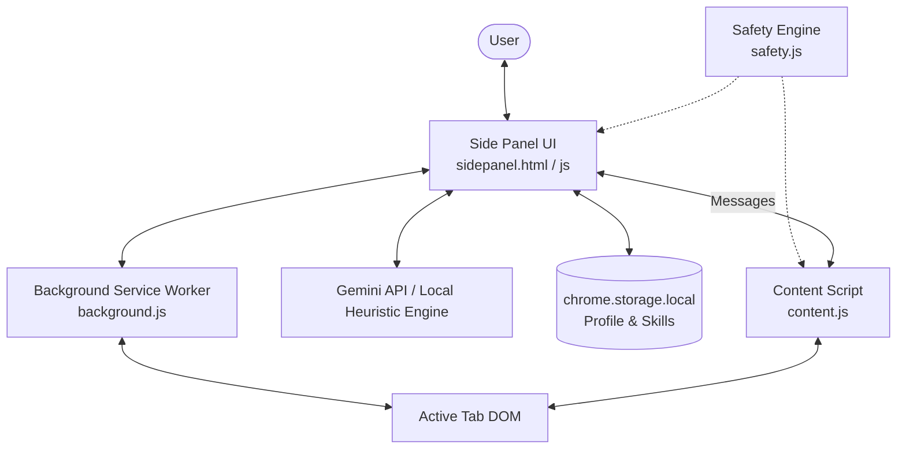
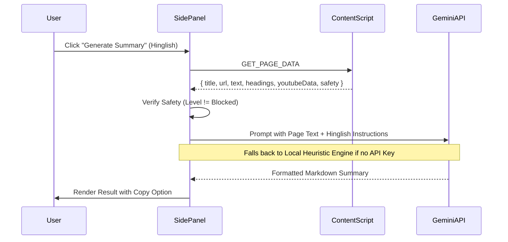
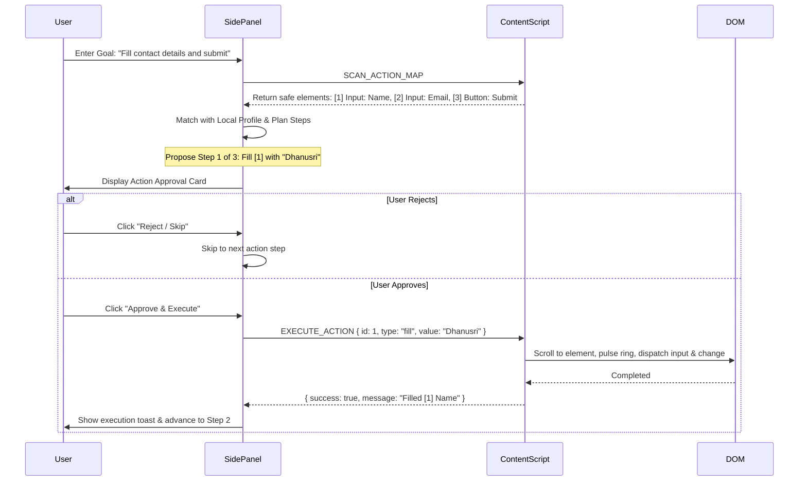

# Sahayak AI Browser Agent — Architecture & Technical Specification

> **System Version:** 1.0.0 (Manifest V3)  
> **Target Platform:** Google Chrome (Side Panel API)  
> **Core Philosophy:** User-controlled, safety-first browser agent that proposes one action at a time and requires explicit human approval.

---

## 1. System Overview

Sahayak is an autonomous, human-in-the-loop AI side-panel browser extension designed to help users comprehend, navigate, and interact safely with any active web page or public YouTube video. 

Built using Chrome Extension **Manifest V3**, Sahayak bridges DOM inspection, multimodal screen vision, on-device safety policies, and Google Gemini LLM reasoning into an integrated side-panel experience.

---

## 2. Component Architecture

The extension is partitioned into five distinct operational boundaries:

### 2.1 Side Panel (`sidepanel.html`, `sidepanel.js`, `sidepanel.css`)
- **Lifecycle:** Runs inside Chrome's dedicated side panel window. Persists as long as the user keeps the side panel open across tab switches.
- **Responsibilities:**
  - Tab coordinator: detects active tab changes and triggers page context refreshes.
  - LLM caller: communicates with the Google Gemini API or triggers the local heuristic engine.
  - Human-in-the-Loop Approval Controller: presents one proposed browser action at a time with Target, Action, and Reasoning, waiting for user confirmation before executing.
  - Multi-feature tab interface:
    1. **Summary:** English and Hinglish summaries for articles and YouTube videos.
    2. **Chat with Page:** Strictly grounded Q&A answering solely from active DOM content.
    3. **Selection Tools:** Explanations (ELI5), translations (Hinglish/English), and profile-backed draft replies.
    4. **Screen Vision:** Multimodal Q&A on visible tab screenshot captures.
    5. **Action Map:** Numbered element browser and sequential action execution.
    6. **Profile & Skills:** Local user profile chips and one-click saved skills.

### 2.2 Content Script (`content.js`)
- **Lifecycle:** Injected into web pages at `document_idle`.
- **Responsibilities:**
  - **DOM Extraction:** Extracts readable body text, headings, meta tags, and selection while pruning noisy boilerplate (`<script>`, `<style>`, ads).
  - **YouTube Video Extractor:** Gathers video title, creator name, description, and chapter timestamps when on `youtube.com/watch`.
  - **Interactive Element Scanner:** Identifies visible `button`, `input`, `a[href]`, `select`, `textarea`, and ARIA role elements.
  - **Numbered Action Map:** Assigns sequential IDs `[1]`, `[2]`, `[3]`... to interactive elements and computes coordinates.
  - **Visual Page Badges:** Injects isolated Shadow DOM badges over webpage elements when toggled on.
  - **Safe Execution Engine:** Scrolls to elements, flashes a glowing pulse halo, and dispatches synthetic input/click events using native property setters to support React, Vue, and Angular controlled inputs.

### 2.3 Safety Engine (`safety.js`)
- **Lifecycle:** Shared module loaded in both Content Script and Side Panel.
- **Responsibilities:**
  - **3-Tier Risk Model:**
    - 🟢 **Safe:** Standard pages and inputs. Actions allowed with step-by-step confirmation.
    - 🟡 **Caution:** Authentication and login pages. Content reading allowed; password and credential automation blocked.
    - 🔴 **Blocked:** Banking domains (e.g. HDFC, ICICI, SBI, Chase, PayPal), internal system schemes (`chrome://`, `about:`), and payment gateways. All automation locked down.
  - **Element Sensitivity Inspection:** Detects `type="password"`, CVV, credit card patterns, OTP, PIN, and Aadhaar/SSN markers.

### 2.4 Service Worker (`background.js`)
- **Lifecycle:** Event-driven Manifest V3 background worker.
- **Responsibilities:**
  - Configures `chrome.sidePanel.setPanelBehavior({ openPanelOnActionClick: true })`.
  - Handles `chrome.tabs.captureVisibleTab` with concurrency locking to prevent rapid double-capture errors.
  - Listens to tab activation and update events to notify the side panel.

### 2.5 Options Dashboard (`options.html`, `options.js`, `options.css`)
- **Lifecycle:** Opens in a dedicated full tab.
- **Responsibilities:**
  - Manages Gemini API Key and model selection (`gemini-1.5-flash`, `gemini-2.0-flash`).
  - Manages local user profile fields (Name, Email, Phone, Role, Location, Preferred Language).
  - Manages custom domain blacklists and strict security modes.
  - CRUD interface for Saved One-Click Skills.

---

## 3. Data Flow & Execution Lifecycle

### 3.1 Page Grounding & Summarization Pipeline

### 3.2 Human-in-the-Loop Action Execution Pipeline

---

## 4. Threat Model & Safety Guarantees

| Threat Vector | Mitigation Strategy | Enforcing Component |
|---|---|---|
| Automated actions on NetBanking or payment portals | Hardcoded domain blacklist + regex detection on checkout/transfer paths. Immediate `BLOCKED` status. | `safety.js` (`evaluateUrlSafety`) |
| Keystroke capture or autofill on passwords / PINs | Element inspection rejects `type="password"`, `cvv`, `otp`, `cardnumber` attributes. | `safety.js` (`isElementSensitive`) |
| Malicious script injection or `eval()` | Strict MV3 Extension CSP; all code uses pre-compiled event listeners; no `eval()` or inline scripts. | Extension Architecture |
| CSS bleed from host website into badges | Floating badges are rendered inside a Shadow DOM container (`#sahayak-action-overlay-root`). | `content.js` (`renderBadgesOnPage`) |
| Accidental multi-step runaway automation | Strict 1-action-at-a-time pipeline. Queue pauses and waits for explicit user click on "Approve". | `sidepanel.js` (`presentNextActionStep`) |

---

## 5. Free-Tier & Local Fallback Design

Sahayak requires zero mandatory API billing:
1. **Google Gemini Free Tier:** Fully compatible with free Gemini API keys from Google AI Studio (`gemini-1.5-flash`).
2. **Offline Intelligent Heuristic Engine:** When no API key is entered, Sahayak uses an on-device heuristic engine:
   - Extractive text summarization using frequency-weighted lead sentences.
   - Genuine conversational Hinglish translation and rephrasing templates.
   - Deterministic form-to-profile mapper for local action planning.
   - Grounded context retrieval using keyword search across DOM paragraphs.
